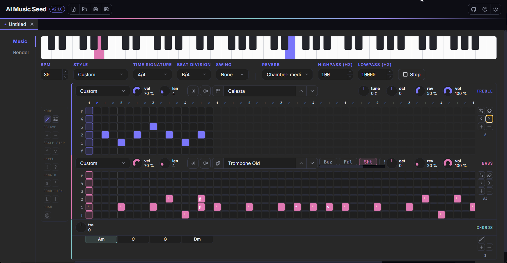

<p align="center">
  
</p>

<h1 align="center">AI Music Seed</h1>

<div align="center">
  <strong>Harmony your AI generator can actually hear.</strong><br>
  Turn a chord progression into an audio seed (plus MIDI) that Suno follows instead of inventing its own.
</div>

<br>

<!-- readme:nav -->

<div align="center">
  <a href="../../releases/latest"></a>
  <a href="../../releases"></a>
</div>

<h3 align="center">
  <a href="https://apps.yaiol.com/p/ai-music-seed/">Website</a>
  <span>&nbsp;·&nbsp;</span>
  <a href="#install">Install</a>
  <span>&nbsp;·&nbsp;</span>
  <a href="#what-it-is">Features</a>
  <span>&nbsp;·&nbsp;</span>
  <a href="#documentation">Documentation</a>
  <span>&nbsp;·&nbsp;</span>
  <a href="#build-from-source">Development</a>
</h3>

<div align="center">
  <sub><a href="https://apps.yaiol.com/p/ai-music-seed/help/"><b>Help in 28 languages</b></a></sub>
</div>

<!-- /readme:nav -->

---

<p align="center">
  
</p>

---

## Install

<div align="center">

<table align="center">
<tr>
<th align="center">Windows</th>
<th align="center">macOS</th>
<th align="center">Linux</th>
</tr>
<tr>
<td align="center"><a href="../../releases/latest"></a></td>
<td align="center"><a href="../../releases/latest"></a></td>
<td align="center"><a href="../../releases/latest"></a></td>
</tr>
<tr>
<td align="center">x64 installer</td>
<td align="center">.dmg, not code-signed</td>
<td align="center">.deb and AppImage</td>
</tr>
</table>

</div>

> **Windows note:** SmartScreen may warn on first launch because the app is not code-signed. Click "More info", then "Run anyway".

The installer puts the app and its 97 instrument sample packs side by side, and registers the `.yams` file type so a double-click opens the seed in the app.

---

## What it is

AI music generators like Suno don't read chord names typed into a prompt - they only follow harmony they can *hear*. AI Music Seed renders a chord progression to a short audio **seed** (plus a MIDI file) that you upload as a Cover or Extend, so the generator locks to your harmony instead of inventing its own.

It's a focused, single-purpose desktop app: type a progression, pick a texture and an instrument, render, upload.

---

## Features

- **Harmony Suno can hear** - renders your chord progression to an audio seed you upload as a Cover or Extend, so the generator locks to your harmony instead of inventing its own.
- **Write real chords** - a full vocabulary: triads through 13ths, suspended, diminished and augmented chords, slash-bass, and rests. Edit them as text, or on a step grid with a chord strip.
- **Three blocks** - a treble, a bass and a chords block, each with its own rhythm figure, instrument, volume, tune and colour.
- **Textures and rhythms** - from a full harmonic bed to a near-silent skeleton that nudges without colouring, or a groove (backbeat, arpeggios that move through the chord) so the generator has a tempo to lock onto and not just harmony.
- **97 instruments** - play any block on the built-in synth or on a sampled piano, electric piano, organ, guitar, harp, strings, choir, brass, winds, marimba and more, all bundled with the app.
- **MP3 or WAV** - export a small MP3 (selectable bitrate, the default for almost every upload) or an uncompressed WAV when you want the raw audio.
- **Play it live** - hit Play and the seed loops instantly, with nothing written to disk. Change the chords, the style, the instrument or the tempo while it plays and you hear it on the next chord - no stopping, no restarting.
- **MIDI alongside** - every render also saves a MIDI of the progression, ready to drop into your DAW.
- **Several seeds at once** - one tab per `.yams` file; open them by dialog, by drag and drop, or by double-click.
- **52 interface languages**, light and dark theme.

---

## Documentation

| | |
|---|---|
| **User manual** | [Read it online](https://apps.yaiol.com/p/ai-music-seed/help/) |
| **Printable PDF** | attached to each [release](../../releases/latest) |
| **What's new** | [Release notes](https://apps.yaiol.com/p/ai-music-seed/help/releases/) |
| **Product page** | [apps.yaiol.com](https://apps.yaiol.com/p/ai-music-seed/) |

---

## Build from source

Requires the Rust toolchain (stable) and, for the installer, the Dioxus CLI (`cargo install dioxus-cli --version 0.7.10 --locked`).

```bash
cargo run                                                       # run in development
cd app && dx bundle --desktop --release --package-types nsis    # Windows installer → release/
```

---

## Architecture

A Cargo workspace. There is no database and no seed persistence: the app opens with a single blank seed each launch, and a seed is kept by saving it to a `.yams` file (a plain JSON text file).

- `engine/` — everything that is not the window: chord text, the figure grammar, the `.yams` document, output names, the sample-pack index, and a small token-protected local server the page's audio talks to. No UI dependency.
- `app/` — the Dioxus desktop shell: the tabs, the Music and Render form, the step grid, settings. The look comes from the shared stylesheet in `app/assets/`; strings come from `locales/<lang>.json`, embedded in the executable at build time.
- `audio/` — the page-side sound: synthesis, sample playback and the WAV / MP3 / MIDI encoders, bundled into `app/assets/audio.js`. The shell pushes the active seed into the page and receives the playhead, the lit keys and finished renders.
- `packs/` — the compiled instrument sample packs, installed as a `packs` folder beside the executable.
- `locales/` — the interface strings, one JSON file per language.

<details>
<summary><b>How a seed is made</b></summary>

The progression is read line by line: each non-blank line is one timing unit of `bars` bars, and the chords on that line **split it evenly** (four chords on a line = a beat each in 4/4; a chord alone on a line holds the whole bar). A number in front of a chord weights it: `2Am E G` gives Am twice the time of E or G. `[Section]` headers, blank lines and `|` bar marks are stripped, so a chord chart pastes in almost verbatim.

A **style** is a pairing of two figures, one for the treble and one for the bass, each a short pattern of steps drawn on the grid. A **figure** says how the chord moves; an **instrument** says what it sounds like, and the two are independent.

Supported chords: triads, sixths, sevenths and extensions (`maj7` / `m7` / `7` / `9` / `11` / `13` and their minor/major forms), `sus2` / `sus4`, `dim` / `dim7` / `m7b5`, `aug`, `add9`, slash bass (`D/E`, `Bm/F#`), and rests (`N.C.` / `N.C./B`). Anything the parser doesn't recognise falls back to a major triad on that root, so a typo never crashes the render.

**Name vs Output.** *Name* is what the seed is called; *Output* is what the rendered files are called. Output is a template resolved at render time (`{name}`, `{bpm}`, `{style}`, `{chords}`, and more); a new seed starts at `{name}-{style}-{bpm}`. A seed must be saved before it can render: the audio and MIDI are written into the folder of its `.yams`.

</details>

---

## License

Released under the [MIT License](LICENSE).

### Instrument credits

The sampled instruments come from freely-licensed recording sessions. Thank you to the people who recorded and shared them:

| Author | Instruments |
|---|---|
| Sam Gossner / Versilian Studios (VSCO-2-CE) | Bassoon, Cellos, Chimes, Clarinet, Double Bass, Flute, Harp, Horn, Marimba I, Marimba II, Oboe, Old Trombone, Organ, Piccolo, Recorder, Timpani, Trombone, Trumpet, Tuba, Upright Piano ×2, Violas, Violin, Violins |
| FreePats project (incl. roberto@zenvoid.org, Mateusz Dąbrowski) | Glass, Guitar, Hang, Tubular Bells, Ukulele, Xylophone (VCSL); Kalimba, Jaw Harp, Synth New Age, Synth Pad Bowed, Synth Pad Sweep, Synth Pad Choir, Piano Grand Salamander, Piano Grand YDP |
| Signature Sounds | Choir Aaaah's |
| pjcohen | Celesta, Upright Bass |
| Tim Kahn | Rhodes Mark II |
| OldBassMan | Wurlitzer 200A |
| Project16 | Bass Rickenbacker |

Sources: [VSCO-2-CE / VCSL](https://vis.versilstudios.com/vsco-community.html) · [FreePats](https://freepats.zenvoid.org/) · [Freesound](https://freesound.org/). All sessions are CC0 (public domain) except: Chimes, Marimba II, Celesta, Rhodes Mark II and Wurlitzer 200A ([CC BY 4.0](https://creativecommons.org/licenses/by/4.0/)), Bass Rickenbacker and the two FreePats grand pianos ([CC BY 3.0](https://creativecommons.org/licenses/by/3.0/)).

<div align="center">
  <sub>AI Music Seed is part of <a href="https://apps.yaiol.com">yaiol Applications</a>.</sub>
</div>
